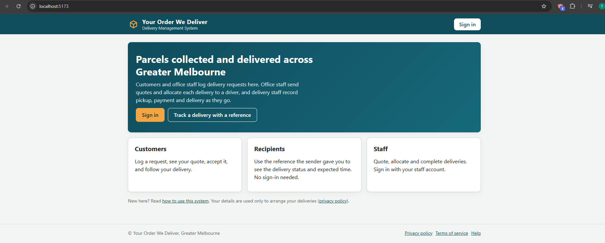
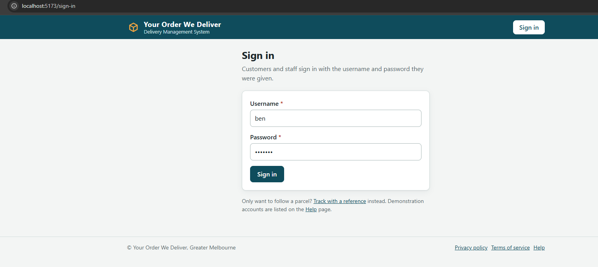
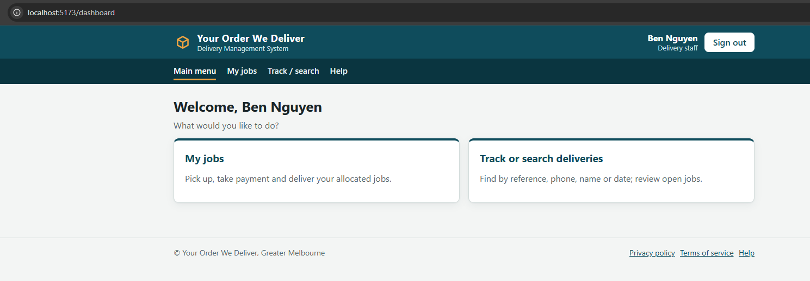
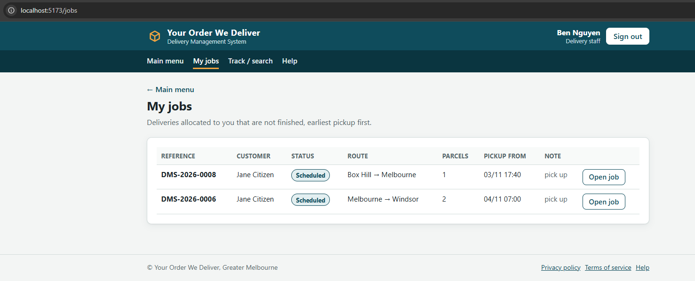
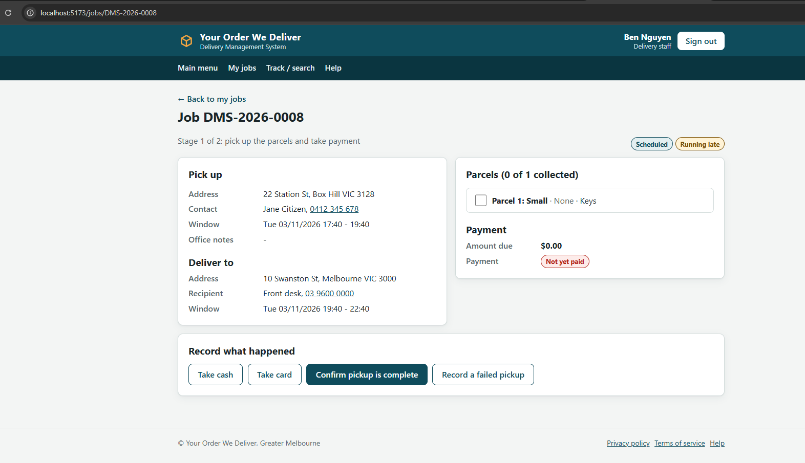
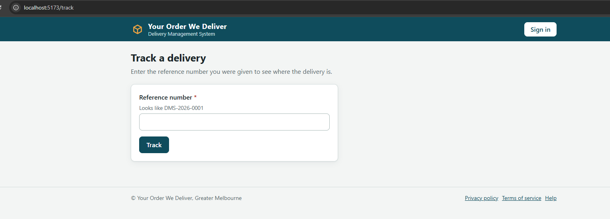
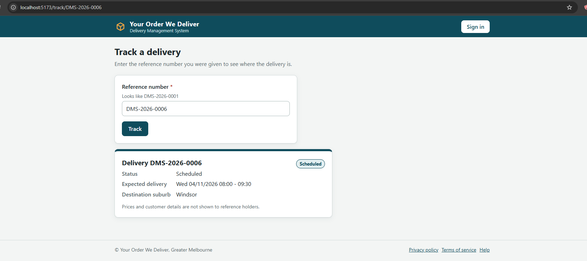

# Delivery Management System (DMS)

.NET 8 web API + Vue 3 / TypeScript UI over a locked domain layer.

## Run

    dotnet run                      # http://localhost:5080 (built UI is served from wwwroot/)
    cd WebUi && npm run build       # only needed after changing the UI

## Test inputs
Delivery Staff:
Log in as ben / pass: demo123, type ref/job DMS-2026-0006

## Checks

| Command | Shows |
|---|---|
| `dotnet build` | Compiles: **Build succeeded, 0 warnings, 0 errors** |
| `dotnet format --verify-no-changes` | Code follows `.editorconfig` (Microsoft conventions) |
| `dotnet run --selftest` | 30 domain checks, PASS/FAIL per line, no web server started |
| `cd WebUi && npm run build` | TypeScript type-check and UI build |
| `cd WebUi && npm test` | UI tests |

## Layout

    Assignment3.csproj          net8.0 Web SDK, RootNamespace Dms
    program.cs                  boot point: DI wiring, endpoint mapping, --selftest
    Domain/                     locked business layer (no UI, no I/O, no clock)
    Api/Contracts/              one interface per business area + the records the UI sees
    Api/Endpoints/              minimal-API routes the Vue app calls (/api/...)
    Api/Controllers/            DeliveryController + DeliveryServiceAdapter (Area 4)
    Api/Demo/DemoBackend.cs     temporary in-memory stand-in for Areas 1-3, tracking, sign-in
    Api/Validation/             InputRules: format checks with actionable messages
    WebUi/                      Vue + TypeScript source (builds into wwwroot/)
    wwwroot/                    built UI served by the API
    Data/                       JSON at runtime
    Docs/                       change log, integration guide, screenshots

## Key flows (screenshots in `Image/`)

1. **Sign in**
   
   
   Enter credentials (e.g. `ben` / `demo123`) on the landing page.

2. **Staff dashboard**
   
   Delivery staff view shows allocated jobs and availability controls.

3. **Job list**
   
   Office staff see the queue of requests awaiting quote or allocation.

4. **Execute delivery**
   
   Driver ticks parcels, takes payment (cash/card), records hand-over or failure.

5. **Track delivery**
   
   
   Customer or office staff search by reference and view status history.

## Contract rules

1. The 9 statuses live in `Domain/status.cs` (`Status` enum). Never use strings, never invent a 10th.
2. No direct status writes: every change goes through `StatusLifecycle.CanTransition` / `ExplainRefusal`, and inside `Delivery` only through its private `Move`.
3. Birth states: a new `DeliveryRequest` starts at `Requested`; a new `Delivery` (created on quote acceptance) starts at `Accepted`.
4. Every public domain command takes a `Guid eventId`; a repeated id is ignored (DA9). A replayed `RecordPaymentAttempt` returns the recorded `Payment`.
5. Timestamps are `DateTimeOffset` parameters supplied by the caller; the domain never reads a clock.
6. No `Console.WriteLine` in domain classes — user-facing text is returned as data. Only `SelfTest` prints.

## Areas and owners

| Interface | Area | Owner | Domain classes |
|---|---|---|---|
| `IRequestService` | 1 Log request | Requests owner | DeliveryRequest, Parcel, CustomerDirectory, ServiceArea |
| `IQuoteService` | 2 Quote + decision | Clarice | Quote, PricingPolicy, QuoteNegotiator |
| `IAllocationService` | 3 Allocate staff | Maleesha | AllocationCoordinator, StaffRegister, DeliveryStaffProfile |
| `IDeliveryService` | 4 Execute + payment | Ky | Delivery, Payment, PaymentMethod, Cash/CardPayment, PaymentGateway |
| `ITrackingService`, `IAuthService` | Tracking, sign-in | AccessPolicy owner | RequestRegister, UserAccount, AccessPolicy |

## Wiring today

- `program.cs` builds one `DmsServices(Auth, Requests, Quotes, Allocation, Deliveries, Tracking, Lifecycle)`.
- Areas 1-3, tracking and sign-in still come from `DemoBackend`; **Area 4 is real** — `DeliveryServiceAdapter` over the locked `Delivery` aggregate.
- `TestDeliveryRegistry` (bottom of `program.cs`) gives that adapter one seeded **Scheduled** delivery: `DMS-2026-0006`, allocated to `ben (S003)`, $34.00. Read models still come from the demo.
- Replace `demo with { Deliveries = … }` with `DmsInitialiser` when the other areas are real; nothing in `WebUi/` changes.

## Endpoints

- `/api/jobs/*` — what the Vue job page calls; goes through `IDeliveryService`.
- `/api/delivery/*` — same commands on a strict-HTTP surface: refusals return **400 + `{ "message": … }`**.

## Known gaps

- Unticking a parcel is not supported: the locked `Parcel` only exposes `MarkCollected()`, so the adapter refuses it.
- Payment is accepted while the job is `Scheduled` or `Collected` (A5 pickup window); declined attempts stay in history (DA4).
- `Storage/` is not implemented — the demo backend keeps everything in memory.
